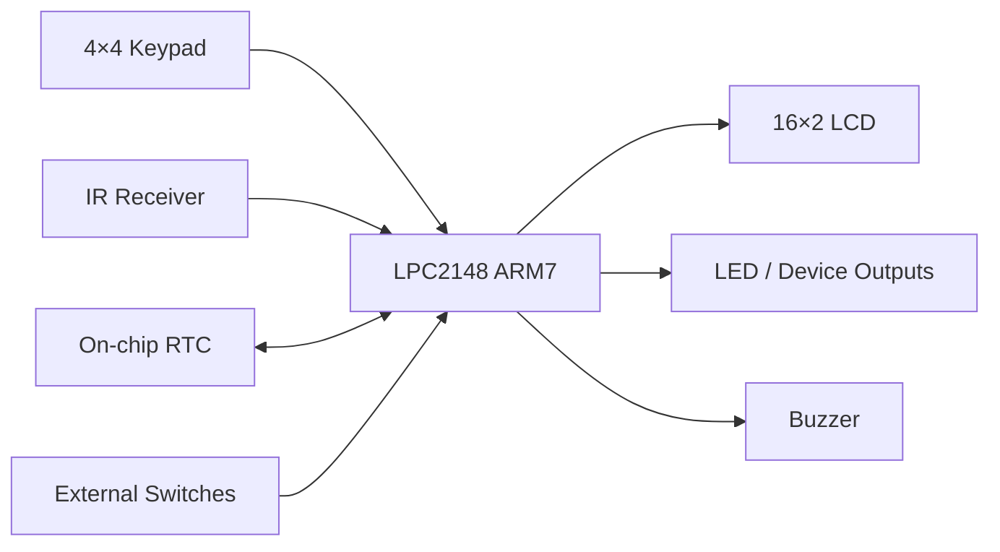
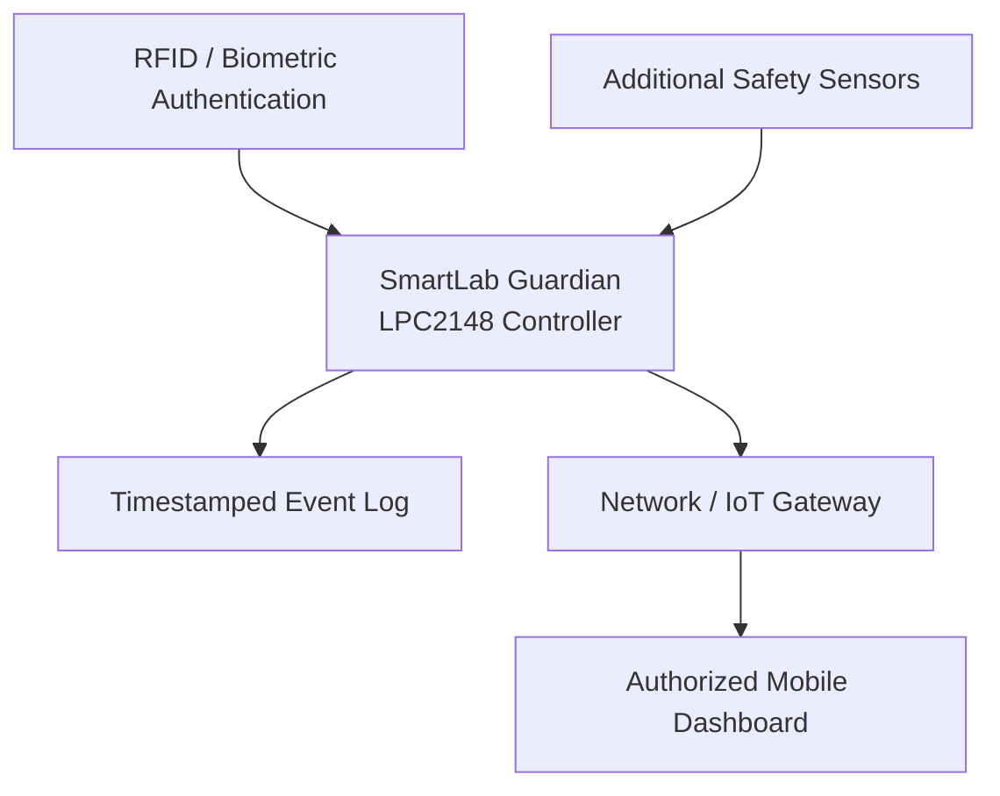
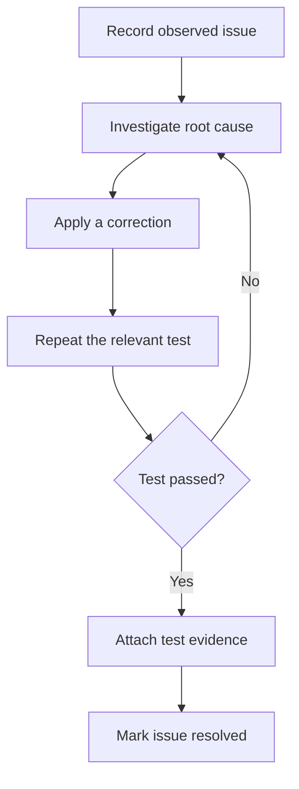

# Challenges and Future Enhancements

> **Project:** SmartLab Guardian: Secure and Automated Laboratory Control System  
> **Controller:** LPC2148 (ARM7) · **Language:** Embedded C  
> **IDE / Compiler:** Keil µVision / ARMCC · **Programming Tool:** Flash Magic


---

## 1. Development Overview

SmartLab Guardian is developed around the LPC2148 ARM7 microcontroller using Embedded C. The project integrates keypad input, LCD display, RTC functions, infrared remote reception, GPIO outputs, and external interrupts.

This document separates implementation considerations identified during code review from proposed future features. A challenge is not described as solved unless the corresponding correction and successful retest have been confirmed.

### System architecture

The following diagram is a functional overview, not a circuit schematic.



---

## 2. Development Challenges and Verification Notes

### 2.1 Integration of Multiple Peripherals

**Challenge:** The application combines several peripherals, including the LCD, keypad, RTC, IR receiver, LEDs, buzzer, and external interrupt inputs. Each peripheral requires suitable GPIO configuration and software routines.

**Implementation approach:** The project separates peripheral functionality into source modules such as `lcd_16x2.c`, `keyPad.c`, `rtc.c`, `IR_Receiver.c`, and `ExtInterruptSwitches.c`, with initialization support in `Initializations.c`.

**Verification required:** Build the complete Keil project and test each peripheral individually before validating their combined operation.

### 2.2 Keypad Input and Validation

**Challenge / review observation:** Keypad scanning and multi-digit input require correct row/column detection and input-length validation. The reviewed keypad routines contain input-count conditions that should be tested with incomplete and boundary-length entries.

**Implementation approach:** Keypad scanning and input routines are implemented in `keyPad.c`; password-related processing is in `passwordCheck.c`.

**Verification required:** Test every key, valid and invalid PINs, short entries, retry behaviour, and PIN-change confirmation. Record any correction and retest result in the issue-tracking table.

### 2.3 RTC Configuration and Operating-Hour Checking

**Challenge / review observation:** RTC operation depends on correct device, clock, prescaler, and hardware configuration. The reviewed `IsWithinTime()` routine compares hour values, so minute-level schedule precision should not be assumed.

**Implementation approach:** RTC operations are in `rtc.c`; initialization and operating-hour checking are in `Initializations.c`.

**Verification required:** Confirm the target device and oscillator configuration, then test times before, at, within, and after the configured operating-hour boundaries. Also verify overnight schedules if they are required.

### 2.4 Infrared Remote Signal Reception

**Challenge / review observation:** The IR receiver decodes RC5-format signals by polling the receiver input and measuring signal transitions. The main application includes a blocking wait for a valid IR frame. While this wait is active, other main-loop tasks may not be serviced.

**Implementation approach:** IR decoding is implemented in `IR_Receiver.c` and called from `main.c`.

**Verification required:** Test the intended TV remote and confirm the decoded address, command, and toggle values. Check whether keypad and other application functions remain responsive during IR reception.

### 2.5 External Interrupt Configuration

**Challenge / review observation:** External interrupt operation depends on matching the LPC2148 pin-selection configuration, interrupt configuration, ISR declaration, and physical switch wiring. The pin definitions and configuration should be cross-checked against the final circuit.

**Implementation approach:** Interrupt initialization is in `Initializations.c`; interrupt service routines and related editing functions are in `ExtInterruptSwitches.c`.

**Verification required:** Confirm the actual EINT pin mapping and trigger configuration. Test emergency and RTC-edit switches separately, then test their behaviour during normal application operation.

### 2.6 Keil Project File Organization

**Challenge:** The repository stores source files and header files in separate directories. The Keil project must therefore reference the correct source-file locations and header include paths.

**Implementation approach:** The Keil project file is `Keil_Project/smartLab.uvproj`; source files are in `Source_Code/` and headers are in `Header_Files/`.

**Verification required:** Open the project after organizing the folders, check all paths and target settings, build it, and confirm that the expected output file is generated.

---

## 3. Future Enhancements

The following are proposed improvements. They are not claimed as features of the current implementation.

| Proposed enhancement | Description |
|---|---|
| **RFID or biometric authentication** | Add an additional authentication method for stronger access control. |
| **IoT-based monitoring** | Add network connectivity and a dashboard for remote status monitoring. |
| **Event logging** | Store authentication attempts, equipment state changes, and emergency events with timestamps. |
| **Mobile application** | Provide a mobile interface for authorized monitoring and control. |
| **Additional safety sensors** | Integrate suitable sensors for detecting environmental or equipment-related abnormal conditions. |
| **Non-blocking IR reception** | Replace long blocking polling with a suitable interrupt- or timer-based reception approach, after checking the LPC2148 pin and timer resources. |
| **Improved schedule resolution** | Extend operating-hour checks to include minutes if required by the application. |
| **Configuration persistence** | Store configurable values in non-volatile memory if persistent settings are required and safely implemented. |

### Possible future system expansion



*Conceptual future architecture only. These additions are not represented as implemented or tested.*

---

## 4. Issue Tracking Record

The following records capture implementation concerns identified during code review. They are listed as **open verification items**, not as confirmed hardware failures. Update each record only after reproducing the behaviour, applying a correction where necessary, and completing a successful retest.

| Issue ID | Observed issue / review finding | Root cause / area to investigate | Correction applied / recommended action | Retest evidence | Status |
|---|---|---|---|---|---|
| CH-01 | Keypad input may accept incomplete or boundary-length entries incorrectly. | Review the key-count conditions and row/column scan handling in `keyPad.c` and the PIN input flow in `passwordCheck.c`. | Check input-length validation, reject incomplete PINs, and verify that only the intended number of digits is accepted. No correction is recorded as applied yet. | Pending: record keypad test results and add the actual test screenshot/video filename. | Open |
| CH-02 | Operating-hour checking may not distinguish times within the same hour. | `IsWithinTime()` currently compares hour values; minute-level schedule precision is therefore not established. | If minute-level scheduling is required, compare hour and minute values and handle normal and overnight time ranges. Confirm the intended boundary rules before changing the code. | Pending: test times immediately before, at, and after both boundaries; attach test evidence. | Open |
| CH-03 | IR reception may temporarily prevent other main-loop tasks from being serviced. | The IR receive routine uses a blocking wait while polling for a valid RC5 frame. | Evaluate a timer- or interrupt-based reception method, subject to LPC2148 resource and pin availability. Retain the current method unless the alternative is implemented and validated. | Pending: test IR reception while checking keypad and other application responsiveness; attach a test video or log. | Open |
| CH-04 | Emergency and RTC-edit switch operation depends on the configured external-interrupt pin mapping matching the physical wiring. | Cross-check the PINSEL configuration, EINT selection, interrupt trigger configuration, ISR setup, and circuit connections in `Initializations.c` and `ExtInterruptSwitches.c`. | Verify the correct LPC2148 pin mapping and trigger settings against the final circuit; make corrections only if a mismatch is confirmed. | Pending: test each switch separately and during normal operation; attach genuine test evidence. | Open |
| CH-05 | The Keil project may fail to locate source or header files after repository folder changes. | Project source paths and header include paths may not match the current `Source_Code/` and `Header_Files/` directory structure. | Review the paths in `Keil_Project/smartLab.uvproj` and the compiler include-path settings; update only incorrect references. | Pending: reopen the project from the repository, perform a clean build, and save the build log or screenshot. | Open |
| CH-06 | RTC time/date behaviour after power interruption needs confirmation. | RTC backup supply and initialization behaviour have not been recorded in this issue log. | Verify the backup-power arrangement and startup/initialization logic. Do not assume that time retention is supported until tested on the actual setup. | Pending: perform a controlled power-interruption test and record the observed RTC values. | Open |

### Issue-tracking workflow



---

## 5. Final Validation Notes

Before declaring the project complete:

- [ ] Confirm the Keil project builds with the intended LPC2148 configuration.
- [ ] Verify the hardware pin connections against the final circuit diagram.
- [ ] Test password authentication and keypad input boundaries.
- [ ] Verify RTC time/date and operating-hour boundary behaviour.
- [ ] Test IR decoding and application responsiveness.
- [ ] Test both external interrupt inputs and their programmed responses.
- [ ] Save genuine test screenshots or videos in the `Testing/` directory.
- [ ] Update the issue-tracking table with actual observations and retest evidence.

---

## 6. Image Asset Notes

The `images/Challenges_and_Future_Enhancements_Overview.png` file is an explanatory infographic summarizing the project architecture, development challenges, and proposed enhancements. It is illustrative documentation, not proof that a particular hardware test was performed.

For evidence of actual operation, add genuine photographs or screenshots from the project. Suggested evidence includes:

| Suggested image | Recommended placement | What it should demonstrate |
|---|---|---|
| `hardware_setup.jpg` | Development Overview | Actual LPC2148 board, LCD, keypad, receiver, switches, and connected outputs. |
| `keypad_pin_test.jpg` | Section 2.2 | Actual keypad authentication or PIN-change test. Hide real PIN values. |
| `rtc_display.jpg` | Section 2.3 | Actual LCD time/date display. |
| `ir_remote_test.jpg` | Section 2.4 | Actual remote and receiver setup during a test. |
| `interrupt_test.jpg` | Section 2.5 | Actual emergency and RTC-edit switch test setup. |
| `keil_build_result.png` | Section 2.6 | Genuine Keil build output. |
| Test screenshots or video | Section 5 | Evidence of completed validation tests. |

Example of embedding a genuine repository image:

```markdown

```
