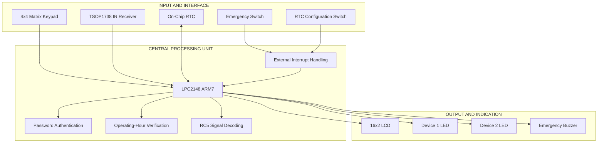
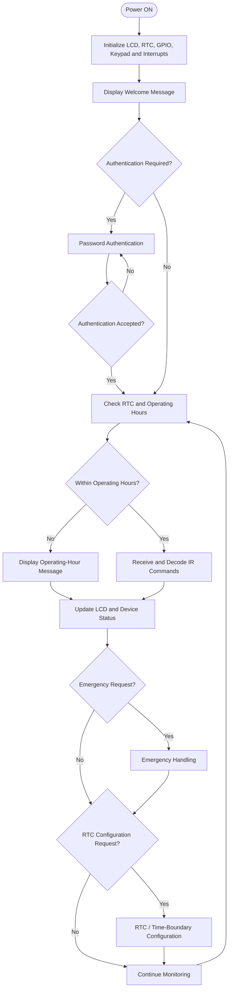
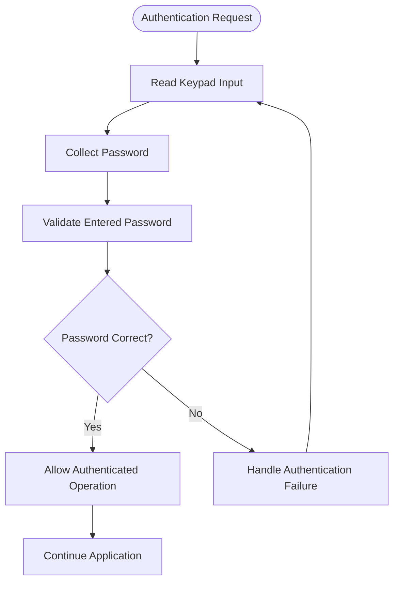
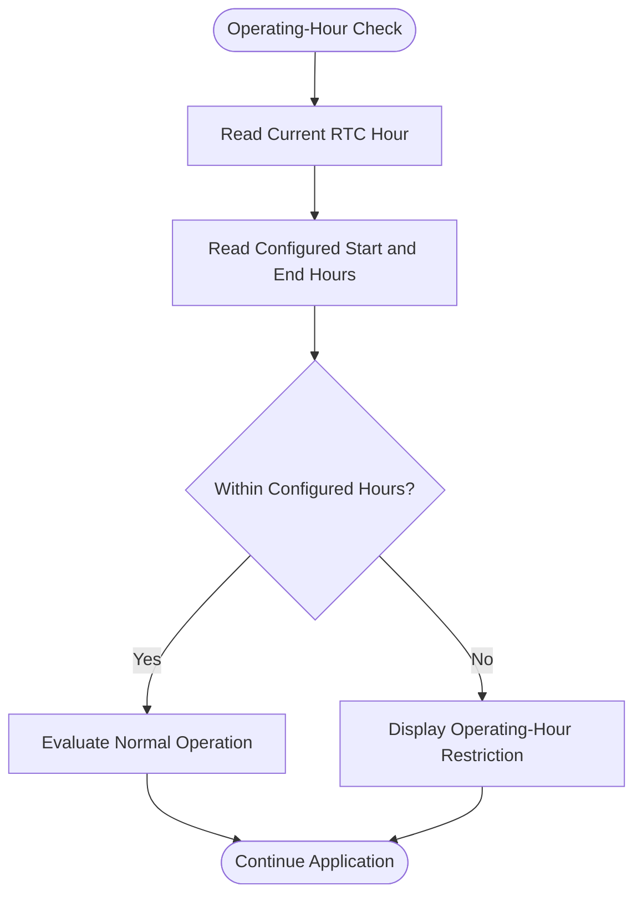
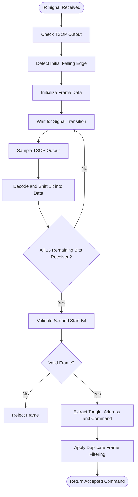
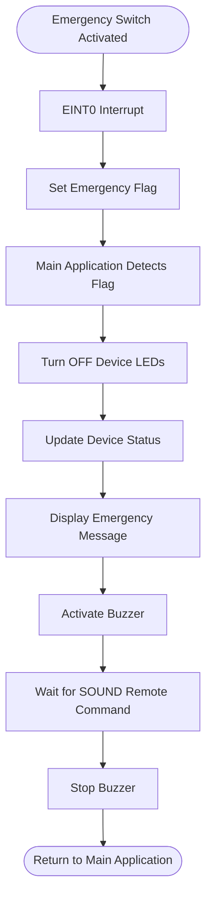

# 🛡️ SmartLab Guardian
### Secure and Automated Laboratory Control System

<p align="center">
  <strong>An LPC2148 ARM7-based embedded system for secure laboratory access, scheduled equipment control, infrared supervision and emergency handling.</strong>
</p>

<p align="center">
  
  
  
  
</p>

<p align="center">
  
  
  
  
</p>

---

## 📑 Table of Contents

- [📌 Project Overview](#-project-overview)
- [🎯 Objectives](#-objectives)
- [✨ Key Features](#-key-features)
- [🏗️ System Architecture](#️-system-architecture)
- [🔄 Project Workflow](#-project-workflow)
- [🔐 Password Authentication](#-password-authentication)
- [⏱️ RTC and Operating-Hour Management](#️-rtc-and-operating-hour-management)
- [📡 IR Remote Communication](#-ir-remote-communication)
- [🚨 Emergency Handling](#-emergency-handling)
- [⚙️ Hardware Requirements](#️-hardware-requirements)
- [💻 Software Requirements](#-software-requirements)
- [📂 Repository Structure](#-repository-structure)
- [🖥️ Output Gallery](#️-output-gallery)
- [🧪 Testing and Validation](#-testing-and-validation)
- [🛠️ Build Instructions](#️-build-instructions)
- [⚡ Programming the Controller](#-programming-the-controller)
- [🧩 Challenges and Solutions](#-challenges-and-solutions)
- [🚀 Future Enhancements](#-future-enhancements)
- [🏢 Applications](#-applications)
- [👨‍💻 Author](#-author)

---

## 📌 Project Overview

**SmartLab Guardian** is a secure and automated laboratory control system developed using the **LPC2148 ARM7 microcontroller** and Embedded C.

The system integrates multiple embedded peripherals to provide controlled laboratory access, scheduled equipment operation, remote supervision and emergency response.

A keypad-based authentication mechanism manages administrator access, while the on-chip Real-Time Clock (RTC) maintains the current date and time for operating-hour verification.

An infrared receiver (TSOP1738) receives commands from a standard TV remote. The software decodes the received signals using the RC5 protocol and makes the address, command and toggle information available to the application.

External interrupts provide dedicated mechanisms for emergency handling and RTC configuration.

### 🔍 System at a Glance

| Parameter | Description |
|---|---|
| Project | SmartLab Guardian |
| Controller | LPC2148 ARM7 |
| Programming | Embedded C |
| Authentication | 4×4 Matrix Keypad |
| Time Management | On-chip RTC |
| Remote Communication | TSOP1738 with RC5 decoding |
| Display | 16×2 LCD |
| Device Indication | LEDs |
| Emergency Alert | Buzzer |
| Interrupt Handling | EINT0 and EINT3 |
| Development Environment | Keil µVision |

---

## 🎯 Objectives

- Implement keypad-based password authentication.
- Control laboratory operation according to predefined operating hours.
- Integrate RTC-based date and time management.
- Provide remote supervision using a standard TV remote.
- Decode RC5 infrared communication signals.
- Display system information through a 16×2 LCD.
- Represent connected equipment status using LEDs.
- Implement emergency shutdown through an external interrupt.
- Provide an interrupt-based facility for RTC and operating-time configuration.

---

## ✨ Key Features

| Feature | Description |
|---|---|
| 🔐 Password Authentication | Keypad-based administrator authentication |
| ⏱️ Time-Based Operation | RTC-based operating-hour verification |
| 📡 IR Remote Control | RC5 command reception and decoding |
| 🖥️ LCD Interface | System messages, time and device status |
| 💡 Device Indication | LED-based equipment status representation |
| 🚨 Emergency Handling | EINT0-triggered emergency response |
| ⚙️ RTC Configuration | EINT3-triggered configuration mode |
| 🔔 Audible Alert | Buzzer indication during emergency handling |
| 🔄 Modular Firmware | Separate source and header files for peripherals |

---

## 🏗️ System Architecture

The LPC2148 is the central processing unit. It receives information from the keypad, RTC, infrared receiver and external switches. Based on the application logic, it controls the LCD, LEDs and buzzer.

### 🖼️ System Block Diagram

<p align="center">
  
</p>

<p align="center">
  <em>Centralized LPC2148 architecture showing input peripherals, processing and output devices.</em>
</p>

> **Image asset:** Add your final SmartLab Guardian block diagram at `Hardware/Block_Diagram/SmartLab-Guardian-Architecture.png`.

### 🔷 Functional Architecture



### 🧩 Functional Modules

| Module | Responsibility |
|---|---|
| Main Application | Coordinates the overall system |
| Initialization | Configures peripherals and system startup |
| Keypad | Reads administrator input |
| Password Check | Handles password authentication |
| RTC | Maintains date and time |
| IR Receiver | Receives and decodes RC5 signals |
| LCD | Displays messages and status |
| External Interrupts | Handles emergency and RTC configuration requests |
| Delay Functions | Provides software timing functions |

---

## 🔄 Project Workflow

The following flowchart illustrates the overall application sequence.



> This diagram represents the documented application flow. The actual execution order and interrupt response are determined by the firmware implementation.

### Step 1 – System Initialization

- Initialize the LCD.
- Configure the RTC.
- Initialize keypad and GPIO.
- Configure LED and buzzer outputs.
- Configure external interrupts.
- Display the welcome message.

### Step 2 – Password Authentication

- Accept the administrator's password through the keypad.
- Check the entered password using the authentication routine.
- Handle access according to the authentication result.
- Provide password management functionality, including PIN change where supported by the application.

### Step 3 – Operating-Hour Verification

- Read the current time from the RTC.
- Compare the current hour with the configured laboratory start and end times.
- Evaluate whether the system is within the permitted operating period.

### Step 4 – Infrared Remote Supervision

- Receive infrared signals through the TSOP1738.
- Decode RC5-format frames.
- Extract address, command and toggle information.
- Process supported remote commands in the main application.

### Step 5 – Emergency and Configuration Handling

- Detect external interrupt requests.
- Execute the corresponding emergency or RTC configuration routine.
- Update the LCD and device indications.

---

## 🔐 Password Authentication

The keypad provides the administrator input interface.

The authentication module handles password entry and validation before the protected application functionality is accessed.



**Related source files:**

- `passwordCheck.c`
- `passwordCheck.h`
- `keyPad.c`
- `keyBoard.h`

---

## ⏱️ RTC and Operating-Hour Management

The LPC2148 on-chip RTC provides date and time information to the application.

The system uses configured start and end hours to evaluate laboratory operating time.

### Operating-Hour Verification



### RTC Configuration

The RTC configuration interrupt provides access to:

- Hour setting
- Minute setting
- Second setting
- Date setting
- Month setting
- Year setting

The administrator can also configure laboratory start and end hours.

**Related source files:**

- `rtc.c`
- `rtc.h`
- `rtc_defines.h`
- `ExtInterruptSwitches.c`

---

## 📡 IR Remote Communication

The system uses a TSOP1738 infrared receiver to receive commands from a standard TV remote.

The receiver software implements RC5 frame reception and decoding.

### RC5 Frame Structure

| Field | Number of Bits | Description |
|---|---:|---|
| Start Bit S1 | 1 | First start bit |
| Start Bit S2 | 1 | Second start bit |
| Toggle | 1 | Distinguishes successive key presses |
| Address | 5 | Remote address |
| Command | 6 | Remote command |
| **Total** | **14** | **Complete RC5 frame** |

### RC5 Reception Workflow



### RC5 Timing Parameters

| Parameter | Value | Purpose |
|---|---:|---|
| `RC5_T` | 1778 µs | Full bit period |
| `RC5_H` | 889 µs | Half-bit period |
| `RC5_Q` | 444 µs | Quarter-bit delay |
| `STEP_US` | 20 µs | Software polling interval |

The receiver uses signal-edge detection and timed sampling to decode the incoming frame.

**Related source files:**

- `IR_Receiver.c`
- `IR_Receiver.h`

---

## 🚨 Emergency Handling

The emergency switch is connected to the EINT0 external interrupt mechanism.

The interrupt service routine sets the emergency flag. The main application subsequently handles the emergency notification and device shutdown.

### Emergency Response Sequence



### Interrupt Configuration

| Interrupt | Type in Firmware | Function |
|---|---|---|
| EINT0 | FIQ | Emergency switch handling |
| EINT3 | IRQ | RTC and operating-time configuration request |

> The interrupt service routines set request flags. The application routines perform the corresponding higher-level operations.

**Related source files:**

- `ExtInterruptSwitches.c`
- `ExtInterruptSwitches.h`
- `main.c`

---

## ⚙️ Hardware Requirements

| Hardware Component | Quantity | Purpose |
|---|---:|---|
| LPC2148 ARM7 | 1 | Main microcontroller |
| 16×2 LCD | 1 | System display |
| 4×4 Matrix Keypad | 1 | Password and configuration input |
| TSOP1738 | 1 | Infrared signal reception |
| TV Remote | 1 | Remote supervisory input |
| LEDs | 2 | Device status indication |
| Buzzer | 1 | Emergency alert |
| Switches | 2 | Emergency and RTC configuration inputs |
| Power Supply | As required | System power |

Additional interfacing components and driver circuits must follow the actual hardware circuit design.

---

## 💻 Software Requirements

| Software / Language | Purpose |
|---|---|
| Embedded C | Firmware development |
| Keil µVision | Project development and compilation |
| ARMCC | ARM target compilation |
| Flash Magic | LPC2148 programming |
| Git | Version control |

**Development note:** Use the compiler and target-device configuration compatible with the supplied Keil project.

---

## 📂 Repository Structure

```text
SmartLab-Guardian/
│
├── README.md
├── LICENSE
├── .gitignore
│
├── Source_Code/
│   ├── Startup.s
│   ├── main.c
│   ├── delay.c
│   ├── lcd_16x2.c
│   ├── keyPad.c
│   ├── rtc.c
│   ├── Initializations.c
│   ├── passwordCheck.c
│   ├── IR_Receiver.c
│   └── ExtInterruptSwitches.c
│
├── Header_Files/
│   ├── all_defines.h
│   ├── defines.h
│   ├── delay.h
│   ├── ExtInterruptSwitches.h
│   ├── IR_Receiver.h
│   ├── keyBoard.h
│   ├── keyBoard_defines.h
│   ├── lcd_16x2.h
│   ├── lcd_16x2_defines.h
│   ├── main.h
│   ├── passwordCheck.h
│   ├── rtc.h
│   ├── rtc_defines.h
│   └── types.h
│
├── Keil_Project/
│   └── smartLab.uvproj
│
├── Hardware/
│   ├── Circuit_Diagram/
│   ├── Block_Diagram/
│   └── Hardware_Images/
│
├── Software/
│   └── Tools_and_Libraries.md
│
├── Documentation/
│   ├── Project_Report.pdf
│   └── Workflow.md
│
├── Testing/
│   ├── Test_Cases.md
│   ├── Output_Screenshots/
│   └── Output_Videos/
│
└── Challenges_and_Future_Enhancements.md
```

---

## 🖥️ Output Gallery

The following sections are intended to document actual LCD outputs and hardware operation.

Add screenshots from the working system to the corresponding folders. Do not use simulated or illustrative images as proof of hardware validation.

### 🚀 System Initialization

<p align="center">
  
</p>

<p align="center"><em>LCD output during system startup.</em></p>

### 🔐 Password Authentication

<p align="center">
  
</p>

<p align="center"><em>Keypad-based password authentication interface.</em></p>

### ⏱️ RTC and Operating-Hour Display

<table>
  <tr>
    <th align="center">RTC Display</th>
    <th align="center">Operating-Hour Status</th>
  </tr>
  <tr>
    <td align="center">
      
    </td>
    <td align="center">
      
    </td>
  </tr>
</table>

### 📡 IR Remote Operation

<p align="center">
  
</p>

<p align="center"><em>Remote command handling and device status indication.</em></p>

### 🚨 Emergency Alert

<p align="center">
  
</p>

<p align="center"><em>Emergency notification and buzzer indication.</em></p>

### 🔌 Hardware Setup

<p align="center">
  
</p>

<p align="center"><em>Complete LPC2148 laboratory control system hardware setup.</em></p>

> **Gallery setup:** These are recommended image filenames. Replace them with actual project screenshots and hardware photographs. Until the files are added, the corresponding images will not display on GitHub.

---

## 🧪 Testing and Validation

The following test cases identify the important functional areas to validate.

| Test ID | Functionality | Expected Behaviour |
|---|---|---|
| TC01 | System initialization | LCD and peripherals initialize correctly |
| TC02 | Correct password | Authentication succeeds |
| TC03 | Incorrect password | Authentication failure is handled |
| TC04 | PIN change | New PIN follows implemented validation |
| TC05 | RTC display | Current date and time are displayed |
| TC06 | Operating-hour verification | Configured operating schedule is evaluated |
| TC07 | IR reception | Valid RC5 frames are decoded |
| TC08 | Duplicate IR frame | Previously accepted duplicate is filtered |
| TC09 | Emergency switch | EINT0 emergency handling is triggered |
| TC10 | RTC edit switch | EINT3 configuration routine is entered |
| TC11 | Device indication | LED states respond to supported commands |
| TC12 | Emergency buzzer | Buzzer responds to emergency handling |

### Test Result Recording

| Test ID | Actual Result | Status | Evidence |
|---|---|---|---|
| TC01–TC12 | To be recorded | Not yet recorded | Add test evidence |

> Update the test status only after executing the test. Attach relevant LCD screenshots, logic-analyzer captures or hardware photographs as evidence.

---

## 🛠️ Build Instructions

Follow these steps to build the firmware using Keil µVision.

1. Install Keil µVision with a compatible ARMCC toolchain.
2. Clone or download this repository.
3. Open the `Keil_Project` directory.
4. Open `smartLab.uvproj`.
5. Verify that LPC2148 is selected as the target device.
6. Check the source-file paths in the project.
7. Verify the header-file include paths.
8. Confirm startup assembly and compiler settings.
9. Select **Project → Build Target**.
10. Review the build output for compilation and linking errors.
11. Generate the HEX file if it is not generated automatically.

### Important Build Notes

- Verify all source and header paths after downloading the repository.
- Confirm that the startup assembly file is included.
- Use the compiler version compatible with the existing project.
- Check the linker output before programming the controller.

---

## ⚡ Programming the Controller

After a successful build:

1. Connect the LPC2148 development board to the computer.
2. Identify the correct serial COM port.
3. Open Flash Magic.
4. Select the appropriate LPC2148 device.
5. Configure the programming interface and bootloader settings.
6. Select the generated HEX file.
7. Program the microcontroller.
8. Reset the board and observe the system.

Refer to the development-board documentation for the correct bootloader and programming connections.

---

## 🧩 Challenges and Solutions

Embedded system integration involves several hardware and software considerations.

The following topics are useful areas for documenting the actual development experience:

| Area | Development Consideration |
|---|---|
| GPIO Configuration | Correct pin direction and peripheral selection |
| LCD Interfacing | Data and control signal handling |
| Keypad Scanning | Row/column scanning and key validation |
| RTC Management | Date, time and operating-hour configuration |
| IR Communication | RC5 timing, signal sampling and frame validation |
| External Interrupts | Interrupt configuration and flag handling |
| Peripheral Integration | Coordinating multiple peripherals |
| Timing Functions | Delay accuracy and software timing limitations |

For each actual issue, record:

1. Problem encountered.
2. Root cause.
3. Debugging approach.
4. Solution implemented.
5. Final verification result.

Refer to [`Challenges_and_Future_Enhancements.md`](Challenges_and_Future_Enhancements.md) for the detailed development notes.

---

## 🚀 Future Enhancements

The following features are possible future improvements and are not claimed as implemented:

- RFID-based administrator authentication.
- Biometric access control.
- IoT-based remote laboratory monitoring.
- Event logging and access-history storage.
- Mobile application integration.
- Additional safety sensors.
- Improved non-blocking IR reception.
- Equipment energy monitoring.
- Advanced fault detection and notification.

---

## 🏢 Applications

SmartLab Guardian can serve as a foundation for:

- Educational electronics laboratories.
- Embedded systems laboratories.
- Research and development facilities.
- Industrial training laboratories.
- Smart campus laboratory environments.
- Controlled equipment-access systems.

---

## 👨‍💻 Author

**SmartLab Guardian – Secure and Automated Laboratory Control System**

**Controller:** LPC2148 ARM7 Microcontroller  
**Programming Language:** Embedded C  
**Development Environment:** Keil µVision  
**Communication:** RC5 Infrared Remote Reception

This repository contains the firmware source code, header files, Keil project, hardware documentation, software requirements and testing documentation.

---

<p align="center">
  <strong>🛡️ SmartLab Guardian</strong>
  <br>
  <em>Secure Access. Intelligent Control. Reliable Operation.</em>
</p>

---

### 📌 Project Documentation Note

This README describes the documented architecture and intended system operation. Actual hardware functionality, implementation details and test results should be verified against the firmware, circuit and recorded validation evidence.
